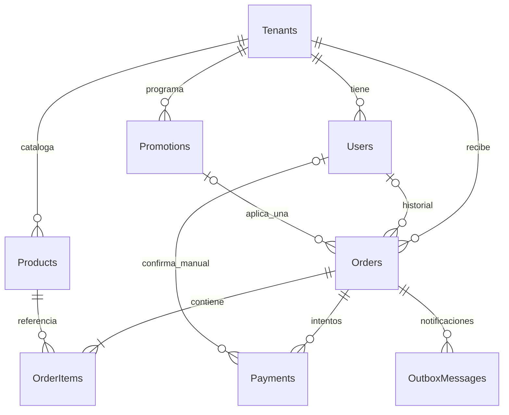

Estado actual: Fase 4 implementada. Ver [Mercado Pago y Docker](FASE4-MERCADOPAGO-DOCKER.md).

Estado actual: Fase 3 implementada. Ver [FASE3-PROMOCIONES-PAGOS.md](FASE3-PROMOCIONES-PAGOS.md).

# Gastronomía SaaS — base .NET 10

Base nueva, compilable y separada del backend anterior de ComercioPedidos. Usa ASP.NET Core 10, EF Core SQL Server 10.0.13 y `net10.0`. Mantiene separado el backend anterior y ahora conecta Expo con el panel local mediante POST /api/pedidos. Ver CHECKOUT.md para el flujo, configuración y pruebas.

## Organización

```text
src/Gastronomia.Domain          Entidades, enums y reglas de dominio
src/Gastronomia.Application     Contratos DTO, casos de uso y contexto de comercio
src/Gastronomia.Infrastructure  DbContext, Fluent API y servicio transaccional
src/Gastronomia.Api             Checkout, panel, autenticación y outbox transaccional
sql                            DDL generado desde EF y triggers históricos
tests/Gastronomia.Checks        Verificaciones de dominio e integración SQL Server
```

El dominio no depende de EF ni de ASP.NET. Application depende de Domain. Infrastructure implementa IOrderService. API compone las dependencias. Se usa IDbContextFactory para crear una unidad de trabajo nueva en cada reintento; no se añade un repositorio genérico que duplique el DbContext.

## Modelo y relaciones



- Cada entidad operativa contiene TenantId. Las relaciones usan `(TenantId, Id)`, además del filtro global de EF. El middleware verifica que un token autenticado pertenezca al comercio de la ruta. Un checkout anónimo puede seleccionar un comercio activo para comprar; nunca para consultar pedidos ajenos.
- Users tiene PK `(TenantId, Id)`: el mismo `sub` de identidad puede existir en varios comercios. La unicidad del email normalizado es por comercio.
- Todos los importes son `decimal(18,2)`. Fechas de operación: `DateTimeOffset` en UTC; horario de promociones: zona configurada en Tenant.TimeZoneId. Una moneda por comercio; no hay conversión monetaria implícita.
- OrderItem captura nombre, precio unitario, cantidad, descuento de línea y subtotal. **DescuentoAplicado es el importe total descontado a la línea, no un porcentaje ni un descuento por unidad.** Fórmula: `Subtotal = PrecioUnitarioHistorico * Cantidad - DescuentoAplicado`.
- Los totales y datos de contacto originales de Order son snapshots. Las propiedades tienen setters privados, el DbContext rechaza cambios y los triggers bloquean UPDATE/DELETE del detalle histórico y cambios del snapshot por SQL directo. El catálogo puede cambiar sin recalcular pedidos anteriores.
- ShortCode usa una SEQUENCE SQL global y un índice único: `#PED-1000`, `#PED-1001`, etc. No se calcula con COUNT/MAX. Puede tener saltos y crecer en longitud. **No sirve como contraseña ni como autorización.**

## Flujo e idempotencia

`CrearPedidoAsync` valida DTO, cantidades, productos del comercio y usuario verificado cuando corresponde. Calcula importes exclusivamente desde la base. TotalEsperado permite detectar cambios entre cotizar y confirmar: nunca reemplaza el cálculo del servidor.

Dentro de una transacción: selecciona la promoción, reserva stock, incrementa CurrentUses, agrega Order/OrderItems y crea un Payment pendiente. Todo se confirma o revierte en conjunto. El resultado incluye código, precios históricos, estados, PaymentId, texto y URL de WhatsApp. Abrir esa URL no confirma el envío del mensaje, la aceptación ni el pago.

El cliente genera un GUID RequestId una sola vez por intento de compra y lo reutiliza ante un timeout. Hay índice único `(TenantId, RequestId)` y hash del payload normalizado. Repetir el mismo pedido devuelve el mismo recurso; reutilizar la clave con otros datos produce HTTP 409. Conserva la clave en React/React Native hasta obtener una respuesta definitiva.

`AceptarPedidoAsync` cambia PendienteConfirmacion → Aceptado y, si se solicita, → EnPreparacion. No vuelve a consumir stock ni usos de promoción. Agrega el evento PedidoAceptado a la outbox en la misma transacción; repetir la aceptación no duplica el evento.

El servicio permite EnPreparacion → Entregado para retiro y EnPreparacion → EnCamino → Entregado para delivery. Las máquinas de pedido y pago son independientes: aceptar o entregar no confirma automáticamente el cobro; confirmar pago no cambia el estado del pedido.

Cancelar un pedido no entregado y no pagado devuelve stock y libera la reserva de promoción una sola vez. Un pedido pagado requiere un futuro flujo explícito de reembolso; no se simula que el dinero fue devuelto.

**Decisión de reservas:** CurrentUses representa reservas vigentes más pedidos no cancelados. Los límites se consumen al crear, no al aceptar; una promoción vencida después de la creación mantiene el beneficio histórico ya reservado. En esta base la liberación es por cancelación explícita. Antes de producción se necesita un job de vencimiento de pedidos pendientes, con la misma transacción de cancelación, para que pedidos abandonados no retengan stock indefinidamente.

## Promociones

- Tipos: PorFecha, PorDiaSemana, PorHorario y Cupon. Pueden tener restricciones adicionales de fechas, días, horario y mínimo de compra.
- Vigencia: `[DesdeUtc, HastaUtc)`, inicio inclusive, fin exclusivo.
- DiasSemanaMask: domingo=1, lunes=2, martes=4, miércoles=8, jueves=16, viernes=32, sábado=64; se suman los días permitidos.
- Si el horario cruza medianoche, la madrugada pertenece al día de inicio. Ejemplo: lunes 22:00 a martes 02:00 usa el bit de lunes.
- Sin cupón: se elige el mayor beneficio entre promociones automáticas aplicables. Con cupón explícito: solo se considera ese cupón, aunque una automática sea mayor. Un cupón inválido o agotado devuelve error; no se sustituye silenciosamente.
- No se acumulan. El descuento fijo se limita al bruto del pedido. Porcentajes se redondean a dos decimales AwayFromZero. El descuento total se distribuye determinísticamente por ProductId entre líneas, con tope por línea; no hay diferencia de centavos entre sumas.
- MaxUses null significa sin límite. CurrentUses y Stock están protegidos con rowversion más CHECKs SQL. Un conflicto, deadlock o carrera de unicidad reinicia toda la operación con un DbContext nuevo, hasta tres intentos. No se hacen reintentos ciegos de notificaciones externas.
- Esta versión aplica promociones al total del catálogo del comercio; reglas por producto/categoría, combos y límites por usuario son extensiones pendientes.

## Invitados e historial

GuestEmail y GuestPhone se guardan incluso en pedidos registrados, como contacto histórico. El email se normaliza con Trim + ToUpperInvariant; no se fusionan alias como `+promo` ni variantes de proveedores.

`VincularPedidosInvitadoAsync(string email, Guid usuarioId)` comprueba en Users el mismo email y EmailVerificado=true dentro de una transacción serializable. Solo actualiza pedidos del comercio, con UsuarioId null y email normalizado coincidente. No transfiere pedidos que ya tienen dueño.

El endpoint de vinculación toma usuario/email del JWT validado, exige `email_verified=true` y también valida la base. Nunca acepta usuarioId ni un email arbitrario en el body. El aprovisionamiento de Users debe venir de un proveedor de identidad confiable; no se incluye un endpoint que permita autodeclarar un email como verificado.

GET mine devuelve historial paginado, con fecha y ambos estados. Los IDs del usuario se extraen del token, no de parámetros de consulta.

## Pagos y notificaciones

Payments permite varios intentos por Order; el flujo inicial crea uno. Índices filtrados impiden dos intentos pagados para un mismo pedido y duplicados de `(Proveedor, TransaccionIdExterna)`.

- Efectivo: un operador autorizado registra el cobro con confirm-manual.
- TransferenciaCBU: el modelo admite ComprobanteUrl HTTPS y transición ComprobanteEnviado. **Adjuntar un comprobante no confirma el pago.** El operador verifica el ingreso antes de confirmar. Subida a storage, URLs firmadas y endpoint de comprobantes aún no están implementados.
- PasarelaOnline: el modelo ofrece ConfirmarPasarela con validación de importe/moneda e identidad externa; el endpoint manual rechaza este método. No se publica un webhook de prueba que acepte un booleano `pagado` del cliente. El adaptador real deberá verificar firma, consultar al proveedor, resolver el pago desde una referencia interna confiable y actualizar Payment y Order en una única transacción. El índice externo debe acompañarse de una inbox de eventos para deduplicar entregas del proveedor.
- EstadoPago=Rechazado existe en el modelo; el caso de uso de rechazo/reintento y reembolsos está pendiente. No es una integración de cobros completa.

OutboxSimulationWorker procesa la outbox con lease, reintentos y un ITransactionalEmailSender intercambiable. En Development usa LocalMailboxEmailSender: captura JSON por evento en App_Data/mail y permite revisarlo desde el panel. Genera avisos PedidoCreado, PedidoAceptado y PedidoEnCamino. No envía emails externos ni WhatsApp automáticamente. ResendEmailSender queda preparado, inactivo hasta configurar el proveedor. La entrega es at-least-once; el buzón deduplica por EventId y Resend recibe una clave de idempotencia. Ver CHECKOUT.md.

## SQL Server y ejecución

Requiere SDK/runtime .NET 10 y SQL Server. La solución no crea ni migra bases automáticamente al iniciar la API.

Desde este directorio:

```powershell
dotnet restore Gastronomia.slnx
dotnet build Gastronomia.slnx --no-restore
```

Crear una **base nueva y vacía** con la herramienta de administración habitual. Ejecutar `sql/schema.sql` (DDL completo con relaciones, CHECKs, índices y triggers). Alternativamente ejecutar `001_schema.sql` y luego `002_history_guards.sql`; no ejecutar ambas alternativas sobre la misma base. Los scripts no borran datos existentes ni convierten las tablas anteriores.

Configurar sin guardar secretos en el repositorio:

```powershell
$env:ConnectionStrings__SqlServer='Server=SERVIDOR;Database=BASE_NUEVA;Integrated Security=true;Encrypt=true'
$env:Authentication__Authority='https://TU-PROVEEDOR-OIDC'
$env:Authentication__Audience='gastronomia-api'
dotnet run --project src/Gastronomia.Api
```

La autoridad y la audiencia deben corresponder a un proveedor real; no hay credenciales ficticias ni bypass de autenticación. Claims esperados: `sub` GUID, `tenant_id` GUID y, para operadores, `role=staff`; para vincular invitados, `email` y `email_verified=true`. Users debe aprovisionarse con ese mismo sub dentro del comercio. Para desarrollo con LocalDB, se puede usar `TrustServerCertificate=true` únicamente en la conexión local; no está habilitado como valor de producción.

Registrar Tenant, Products, Promotions y Users desde un proceso administrativo confiable (el panel de pedidos está disponible; el CRUD del catálogo todavía no). La aplicación móvil actual sigue usando su catálogo local y WhatsApp; la integración con esta API es un paso posterior.

## Controlador

Base: `/api/tenants/{tenantId}/orders`.

| Método y ruta | Acceso | Resultado |
|---|---|---|
| POST / | Invitado o usuario del comercio | Pedido pendiente + payload WhatsApp |
| POST /{id}/accept?iniciarPreparacion=true | staff del comercio | Acepta/prepara, encola notificación |
| PUT /{id}/state | staff del comercio | Transición o cancelación con liberación |
| GET /mine?pagina=1&tamanio=20 | Usuario autenticado | Su historial |
| POST /link-guest | Email verificado | Vincula sus compras de invitado |
| POST /{id}/payments/{paymentId}/confirm-manual | staff + usuario aprovisionado | Confirma efectivo/transferencia; body `{ "importeRecibido": 12330.00 }` |

Los enums JSON se expresan con sus nombres. Las respuestas de error usan ProblemDetails: 400 validación/reglas, 404 recurso fuera de alcance o inexistente, 409 conflicto; autenticación/autorización usa 401/403.

Ejemplo de creación (reemplazar GUIDs por registros reales del comercio):

```json
{
  "requestId": "9d114660-9c9e-487f-bbf1-cac8f5d20821",
  "guestEmail": "cliente@example.com",
  "guestPhone": "5491124830571",
  "metodoPago": "TransferenciaCBU",
  "items": [{"productId": "9e7a7d8e-303d-457e-af36-e7e76d09ec5a", "cantidad": 2}],
  "couponCode": "MARTES"
}
```

No enviar precio, total, UsuarioId ni EstadoPago desde el cliente.

## Verificaciones reproducibles

```powershell
# Dominio/modelo, sin SQL
dotnet run --project tests/Gastronomia.Checks

# Integración con LocalDB: crea y elimina únicamente una base temporal propia
dotnet run --project tests/Gastronomia.Checks -- --sql sql
```

Para otro servidor de pruebas, definir GASTRONOMIA_TEST_CONNECTION. El ejecutor reemplaza InitialCatalog por `GastronomiaChecks_<guid>`, requiere permiso para crear/borrar esa base y nunca usa una base preexistente como destino de escritura. No usar credenciales de producción.

Se verificó: build con 0 errores/advertencias y **77 checks**, incluidos DDL real, precios históricos, estados independientes, idempotencia, reserva/cancelación, concurrencia de stock y cupón, linkeo verificado, mismo usuario en varios comercios, aislamiento por FK/filtros y triggers históricos. Se probaron dos compras completas desde Expo Web (efectivo y transferencia con imagen) y 19 verificaciones HTTP adicionales. No se probó un celular físico, emails externos ni webhooks externos.

Regenerar el DDL base desde el modelo:

```powershell
dotnet run --project tests/Gastronomia.Checks -- --ddl sql/001_schema.sql
```

`schema.sql` es la concatenación de ese DDL y `002_history_guards.sql`. No se usa EnsureCreated al iniciar la API. Para evolucionar bases existentes habrá que introducir migraciones versionadas y un plan de importación de los pedidos previos.

## Alcance pendiente del ERP

Esta entrega cubre la arquitectura base de pedidos, historial, promociones y registros de pago. No incluye inventario de ingredientes/recetas, sucursales, impuestos/facturación, logística avanzada de envíos, caja, auditoría completa de operadores, CRUD administrativo de catálogo/promociones, expiración automática de reservas, limitación de abuso del checkout público, proveedores de identidad/email/storage/pagos ni reembolsos. La autorización por tenant no sustituye los permisos SQL ni la revisión de cualquier consulta SQL directa que se añada.

Referencias técnicas utilizadas: https://learn.microsoft.com/en-us/ef/core/saving/concurrency ; https://learn.microsoft.com/en-us/ef/core/saving/transactions ; https://learn.microsoft.com/en-us/ef/core/querying/filters ; https://learn.microsoft.com/en-us/aspnet/core/security/authentication/configure-jwt-bearer-authentication?view=aspnetcore-10.0

## Panel del negocio

Se agregó `admin/` (React + TypeScript + Vite), servido en `/admin/` por la API. Ver [PANEL.md](PANEL.md) para iniciar el entorno de desarrollo, usar los pedidos ficticios y conocer las limitaciones del acceso local. Está conectado al checkout de Expo y recibe cambios por SSE.

## Fase 2 · cuentas de clientes

Backend OTP/JWT, perfil/direcciones, historial activo/histórico y propuesta de recompra implementados. Ver [FASE2-CUENTAS.md](FASE2-CUENTAS.md) y [fase2.http](fase2.http). Los componentes de cuenta, tracker y liberación del carrito en Expo quedan para la siguiente entrega. No se incluyen favoritos ni ranking.
